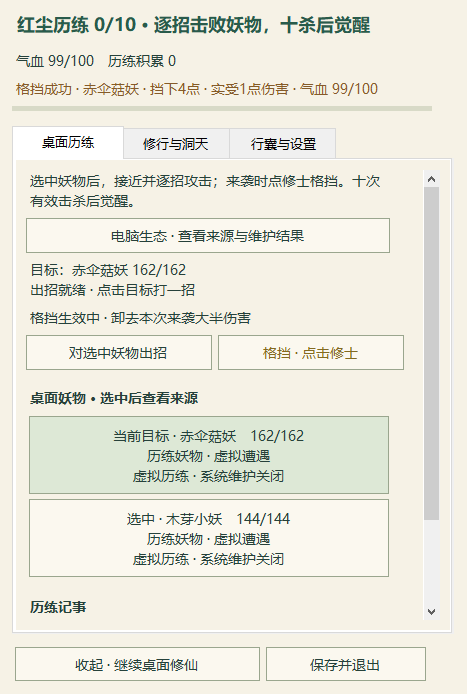

# 收起面板后的桌面战果反馈

命中、受伤和格挡的实际数值现在会在原头顶提示条中短暂显示，无新增窗口。死亡调息、即将受击预警和可觉醒提示仍优先；普通自动命中不能刷掉或延长受伤／格挡反馈。1.8秒真实墙钟后恢复原操作提示。凡人完整手札日志保留，修士普通命中不刷满六条历史。伤害、冷却、射程、存档和维护权限未改变。

## 本轮验证

- 60份生产源码 All -Baseline 56项运行结果通过，包括原selftest和烟测116/20/22/81。
- 短反馈专项同一测试 RED45/12失败 → GREEN45/0；原22项保留。实际StrikeTarget接入在0.8/1/1.2缩放下 RED58/3 → GREEN58/0。受控到期测试只调整UI期限，不改游戏时钟。
- 新凡人正常×1源码原生专项6.142秒、2次实际输入：真实格挡后气血100→99，头顶“挡下4·受伤1”137/137文字像素吻合；手札489/489。四张原图逐张检查。新私有Virtual档，无HP／攻击计时／成长注入、无真实维护；五档保存、真实档哈希保持。该运行器不是交付EXE，未跑十杀觉醒全链。
- 精确交付EXE另以正常×1炼气圆满功能档验证：24.999秒、6次原生点击、34断言、10图通过并逐张查看。含真实破境换装、洞天播种、镜妖战斗、五档保存和同进程Load；功能种子不代表自然成长，Load不是新进程恢复。

EXE `1c5f85eb3149d2f757792accce5d842c44220411baebe64930bda424f98a8e02`；ZIP `1197961876f2fd0855e10f61895b5c616524baaf91c1166ea4536761edd1f977`。63项／31新PNG逐字节与CRC核验；240已有运行档与22旧Assets未改变，main不改，旧版保留在本地 verification/rollback-before-combat-hud-20261023。原始演员截图含其他应用，仅留本地；下图是本程序不透明客户区的原像素裁切。

长测和 automation-3 继续PAUSED。上一轮严格特效像素专项失败仍保留在 ../desktop-continuity-20261023/combat-effect-native-failures.json，本轮没有重跑或改成通过；武器／特效局部被躯干遮挡仍待视觉改善。混合DPI、锁屏／实机拔插、自然首次收获与长时节奏仍未验收，不宣称产品全部完成。
