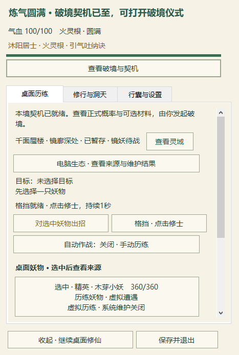
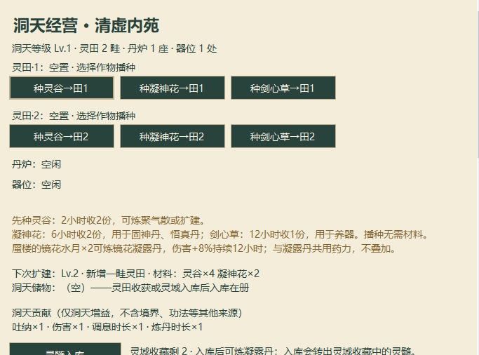
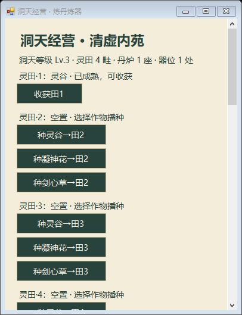

# 桌面回访、洞天田位与战斗特效更新

长测与 automation-3 保持 PAUSED。本轮更新可玩 Demo，不宣称产品整体验收完成。

- 手札保留最多两项回访待办：暂存蜃楼、待战镜妖、合法待选机缘，以及洞天可领取数量。与破境提示并存；按钮只打开已有面板，续行、领取仍由玩家操作。
- 每块已解锁灵田可独立选择三种原作物、在对应田位收获；炉、器领取也与状态相邻。显示实际 UTC 剩余时间、药力时限、器灵效果和洞天贡献倍率，沿用原配方与成长规则。四田窄窗需要滚动。
- 新美术战斗特效从192缩至144逻辑像素，锚点移至腰腿；修士位于特效之上，特效位于当前目标上方。保留旧入口、攻击距离、速度、伤害、冷却及持续时间。

## 验证

60份生产源码 All -Baseline：56项运行结果全过（含原 selftest 与烟测116/20/22/81）。专项：回访28/0、洞天42/0、层级与特效55/0；同测试 RED 分别21/17/21失败保留。洞天成熟与动作时序使用受控私有夹具，不代表自然等待或首次真实收获。

精确交付 EXE：正常×1私有炼气圆满功能档21.156秒、6次原生点击、34断言通过，10张真实截图逐张检查。包含正式破境换装、洞天播种、镜妖战斗、五档保存和同进程生产Load；不是自然成长或新进程恢复。

另以相同生产源码编译的专用运行器：准备4.547秒/4点击，再由真正新进程恢复9.810秒/4点击。手札待办正文和按钮通过原生字形门禁；点击后只打开原暂停面板，完整探索指纹保持，必须主动续行才出现原镜妖，再经实际战斗结算。8张主要原生图均已查看；此证明不冒充交付EXE自身的新进程测试。

**拥挤特效原生专项仍失败。** 两轮各12秒、三帧全部查看。人物/七妖物像素与命中、真实Z及全原始alpha的脸/提示/HUD特效遮挡均通过；严格特效像素证据不足。第一轮前两帧有足量不透明样本，12秒淡出特效没有；第二轮可核实样本27/42/12，少于既有100门槛，匹配率虽为100%也不判通过。半透明仅在已核实自有不透明底帧上合成，未知桌面底色跳过。保留两次失败、原图与全部门禁，不再反复采集直到侥幸通过。见 combat-effect-native-failures.json。

不承诺任意密度无叠体、武器与手部无相交或所有特效始终可见。原生专项短资源数据含截图/像素检查成本，不作为低占用或长期稳定结论。混合DPI、实机拔插、锁屏恢复、自然首次收获与长时节奏继续保留；长测不恢复。

## 交付与隔离

EXE `d6a55ccc223488323335ce0b78434cc8e633bd892b6ca1ae3258715e7a9189e0`；ZIP `c3e2aff0b38a2075ff3147e1d9a8ccafbaaf64b047244a0ee0b23a0a850b80ff`。63项/31新PNG逐字节与CRC通过；240份原运行档和22份旧Assets哈希不变，main仍5f8151a。仅更新独立美术Demo的EXE/config；旧包在本地 verification/rollback-before-continuity-20261023 可回滚。维护授权始终独立，未处理用户文件或进程。

以下两图是已查看的真实桌面中本程序不透明客户区原像素裁切，不含其他应用；完整原图只留本地。

下面仅为390像素窄窗的隐藏控件渲染，使用受控四田成熟夹具，不能当作原生桌面或自然收获证据。

