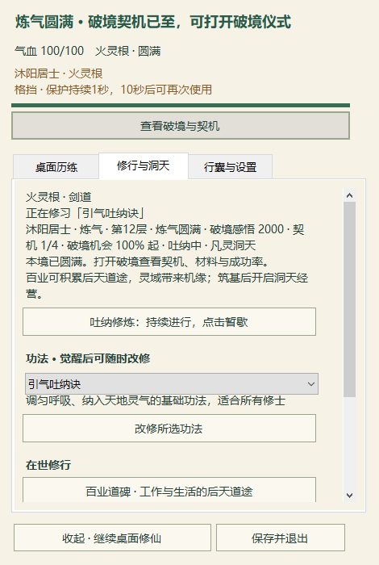
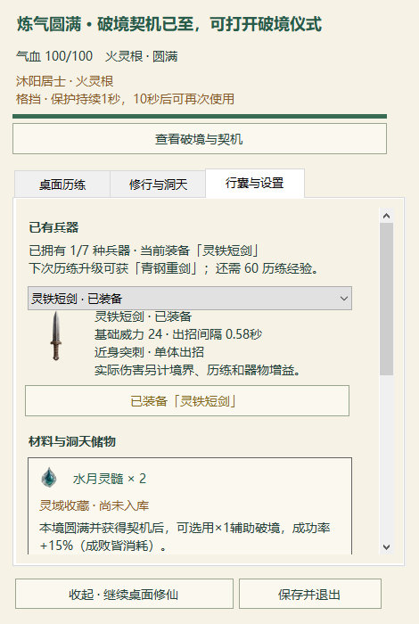

# 透明桌面密集战斗与后台开销更新

长测与 automation-3 保持暂停。交付 EXE `7e58e2dc723ac533eab811bc0f8f9310c34952f0b78cc98ed767816d310a2db9`；ZIP `a01563819376aff78e95902ec09574c09a19a32b753a5c0ea128dba3564c0d10`。本轮继续推进可玩 Demo，不代表全部产品验收。

- 密集战斗按实际插画与名条占位让开人物头部、动作提示、境界条和后加入的 Boss；未选怪物可以在外圈等候，选中后仍须走入原近战距离才能攻击。旧两三只普通怪路径保留，伤害、速度、冷却和授权不改。
- 相对层级为拖动对象、人物与提示、当前目标、其他妖物。只修正演员间顺序，保留已在它们上方的面板／其他窗口；不抢焦点，不创建整屏覆盖层。
- 系统来源使用「内存分身」「磁盘危机」「磁盘空间预警」，同一窗口在警告与可处理批次切换时同步更新名称；镜妖、虚拟怪和程灵名称保留。
- 文件身份路径读取从短缓冲开始，按 Win32 所需容量最多重试一次，保留32768上限与原身份／目录锁／删除前复核。100次自有短路径调用管理分配从13,194,208B降到196,608B；这笔分配改善单独测时没有明显降低CPU。
- 后台普查完成后才计休息：安静时至少2秒、dirty至少0.35秒，并受本次扫描耗时3倍、最多15秒的共同预算限制；手动刷新仍可立即发起且不并发。保留未消费的文件变化，失败／取消／epoch变化同样避免紧密重扫；耗时使用本次不可变起点。

## 本轮证据

All -Baseline 52项运行结果全过，包括旧selftest与烟测116/20/22/81；专项站位292、层级与标记22、来源38、路径31、调度26项通过。RED记录均在本地保留，没有放宽旧274项站位测试。源码指纹见 production-source-hashes.json。

正常×1源码拥挤夹具运行12.33秒，6只普通怪和最后追加的内存Boss，共8个透明演员；8/12秒各抓一张真实Windows桌面图，原生命中与像素检查通过，已逐张查看。仅使用先前正常×1十杀觉醒档的五主档副本，初始位置人为设为密集；不是自然发现或交付EXE本身。源档、真实档和前台焦点保持；维护、扫描和原生输入为零。资源结果含截图核验成本，见 crowding-native.json；原始其他应用背景图只留本地。

交付精确EXE的私有炼气圆满功能档、正常×1原生流程通过，34检查／10截图已逐张查看，包括拖动、正式破境换装、洞天播种、关面板继续、镜妖、五档保存与同进程Load。见 final-exe-native.json；功能档不等同自然养成，Load不等同真新进程恢复。

背景探测角色完全隐藏、零呈现帧。修前约1.037逻辑核；单改缓冲1.024核；最终8秒对照Observe0.502核/Virtual0.033核。最终24秒运行的有效窗21.303秒为0.303核（本机12逻辑核约2.52%），3次扫描启动/2次完成，实际两次完成后静息7.861/7.376秒再启动。不能据不同有效窗和实时Temp快照宣称固定降低百分比、可见战斗平均或长期稳定；普查仍受原有边界限制，Complete=false如实保留。

便携包63项／31新PNG／22旧Assets，CRC与逐项字节核验通过，不带档案、授权或原始影像。运行目录240份已有档案SHA不变，旧Assets与稳定main一致，仅替换本分支Demo的EXE/config；旧版完整回滚保留。

以下是上述最终 EXE 在真实桌面上的不透明客户区原像素裁切，分别为修行与行囊；功能种子档，裁切过程与原片 SHA 见 native-crop-provenance.json。

## 尚未关闭的范围

普通怪的头部／HUD／Boss避让指标不含Boss自身与战斗特效。8秒原图的Boss攻击特效仍经过人物面部，12秒原图有武器／手部局部交叠，不能作为“人物和全部特效始终无遮挡”的展示证明。当前目标为近身攻击进入人物附近是允许行为；本轮不承诺满预算11演员、任意小工作区完全无交叠。首次native失败来自夹具误要求穿透特效接收点击；原报告保留，修正只针对decoration，未放宽人物／妖物的像素及命中门禁。

混合DPI、真实拔插与锁屏恢复、首次自然收获、长期节奏仍未验收。长测不自行恢复，main和正式环境不替换。
