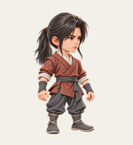

# 凡人主角 · M2 正式基准

日期：2026-10-18。**产品已正式选择 [M2-v2](../round-02-directed/raw/M2-v2.png) 作为凡人期标准主角基准，并批准其核心设计。** 人物不再重新选择；本轮仅交付一张当前小幅精修和一张当前预览。精修 v2（`mortal-M2-polish-v2`）已生成，**待产品最终确认**，不能视为精修已确认或游戏美术验收通过。内部 v1 过程稿保留，不算新增候选。

## 已锁定的核心设计

- 低马尾、侧分碎发，眼神冷静坚定，保持 M2-v2 的同一人物身份与面容。
- 红褐色短交领衣、灰裤、布靴，仅保留一枚小旧铜佩。
- A｜国漫仙侠·精致微缩风，高质量 2.5D，约 2.8—3 头身；沿用右向四分之三视角与左上柔光。

精修仅小幅简化密纹、加强凡人的朴素感，不更换人设、发型、衣装主结构、配色或铜佩，不新增布囊及其他饰品。不能把修改目标提前写成“已完全去纹”或“已消除成熟感”；实际效果以精修图及产品最终确认记录为准。

当前精修仍有自然细纹，朴素感、成熟感与侠客气质的平衡仍待产品审核。下图为 220×240 浅底预览，点击查看高清原图。

## 文件与审核状态

| 文件 | 用途与状态 |
| --- | --- |
| [baseline/M2-v2.png](baseline/M2-v2.png) | 已批准基准的精确副本；与上轮 M2-v2 的 SHA-256 一致，基准图未重绘或处理 |
| [raw/mortal-M2-polish-v2.png](raw/mortal-M2-polish-v2.png) | 当前单张小幅精修图，使用内置 GPT Image/imagegen 制作；已生成，待产品最终确认 |
| [previews/mortal-M2-polish-v2-220x240-light.png](previews/mortal-M2-polish-v2-220x240-light.png) | 当前 220×240 浅底预览，底色 `#F2F0E8`，用于小尺寸审核，不代表运行渲染验收 |
| [prompts/mortal-M2-polish-v2.txt](prompts/mortal-M2-polish-v2.txt) | 当前 v2 精修提示词，记录保留项与仅处理衣料表面的修改范围 |
| [preview-report.json](preview-report.json) | 当前对应精修 v2，记录原图与预览的哈希、尺寸、透明范围及等比缩放参数 |
| [generation-record.json](generation-record.json) | 记录基准来源、生成版本、文件与审核状态；与产品确认记录分别保留 |

精修高清原图为 1024×1536、RGBA，alpha 范围 0..254；低 alpha 边缘像素保留。预览仅等比缩小并合成浅底，未修改源 PNG。这些文件和数值记录不代表图像 QA 或游戏验收通过。原始 PNG 为光栅图，不是分层 PSD，也不是已制作完成的游戏部件。

## 内部版本记录

| 版本 | 处理与状态 | 保留文件 |
| --- | --- | --- |
| 精修 v1 | 首次小幅精修，密纹收敛仍不明显；作为内部过程稿保留，不作为当前新增候选交付 | [原图](raw/mortal-M2-polish-v1.png) · [提示词](prompts/mortal-M2-polish-v1.txt) · [浅底预览](previews/mortal-M2-polish-v1-220x240-light.png) · [旧预览报告](preview-report-v1.json) |
| 精修 v2 | 在同一身份基础上仅进一步处理衣料表面，仍保留自然细纹；当前唯一待最终确认的精修图 | [当前原图](raw/mortal-M2-polish-v2.png) · [当前提示词](prompts/mortal-M2-polish-v2.txt) · [当前预览](previews/mortal-M2-polish-v2-220x240-light.png) |

## 后续顺序

先由产品确认这张凡人精修图，确认后直接基于同一人物设计炼气阶段，不重新选人物。当前不生成炼气或筑基，不拆 12 格图集，不制作或接入游戏分件，不修改 `Assets`、代码或历史技术规范。分件、隐藏连接区、锚点、动画及实际运行效果仍需后续制作和验收；JSON 锚点继续为技术方案。

选择过程见[第二轮定向微调](../round-02-directed/README.md)，既定方向和技术边界见[美术重制第一阶段](../../../设计/美术重制第一阶段/README.md)及[标准修士角色视觉设计方案](../../../设计/美术重制第一阶段/标准修士角色视觉设计方案.md)。历史候选、当时审核状态及建议继续保留，本次正式选择以本记录为准。
