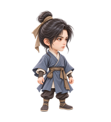
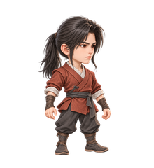

# 凡人主角 · 第一轮候选

日期：2026-10-18。状态：**v4 待产品审核，尚未选择人物身份或确认定稿。**

整体方向沿用 **A｜国漫仙侠·精致微缩风**：高质量 2.5D、约 2.8—3 头身。流程为 Codex 使用内置 GPT Image/imagegen 生成候选 → 产品审核 → 修改确认 → Codex 制作游戏资产 → 接入与验收。本目录先提供 A1、A2、A3 三个凡人人物方向，供选择和提出修改；它们不是同一人的三阶段。

本轮约束为右向四分之三视角、统一左上柔光、全身及双脚完整，保留动作和武器空间，优先真透明 PNG，无文字、水印或边框；凡人不带灵气光环、华丽武器及高阶饰品。是否达到这些视觉要求仍待产品逐张审核，本文不作视觉验收通过声明。

## 当前待审图

以下小图由 v4 原图生成，为各自的 220×240 透明预览，点击可查看对应高清原图。请按 100% 像素查看小尺寸可读性，并同时查看浅、深底版本；图片查看器放大后的效果不能代替实际尺寸判断。

| 候选 | 220×240 透明预览 | 造型方向与查看链接 |
| --- | --- | --- |
| **A1 · 清简书生** |  | 高髻、蓝灰交领短袍，气质温和。 [v4 高清原图](raw/A1-v4.png) · [透明预览](previews/A1-220x240.png) · [浅底预览](previews/A1-220x240-light.png) · [深底预览](previews/A1-220x240-dark.png) |
| **A2 · 山野行者** |  | 短发头带、苔绿背心、米白衫、土色裤，气质亲和。 [v4 高清原图](raw/A2-v4.png) · [透明预览](previews/A2-220x240.png) · [浅底预览](previews/A2-220x240-light.png) · [深底预览](previews/A2-220x240-dark.png) |
| **A3 · 利落少年** |  | 低马尾、赭红短衣、炭灰裤，神情专注。 [v4 高清原图](raw/A3-v4.png) · [透明预览](previews/A3-220x240.png) · [浅底预览](previews/A3-220x240-light.png) · [深底预览](previews/A3-220x240-dark.png) |

三张分别生成并独立保存，没有拼成三人信息图。三个人物候选可供阅读和比较，光照与比例仍以产品审核为准；后续制作时须统一清边与锚点。审核时重点比较脸部、发型、气质、剪影及配色，确认身份差异是否足够，以及哪一位适合作为后续长期成长的主角。

## 版本与来源

三组候选各保留 v1、v2、v3、v4，共十二张原始 PNG 及对应提示词，均由内置 GPT Image/imagegen 生成。当前 v4 原图为 **1024×1536、RGBA**。

| 版本 | 迭代状态 | 文件 |
| --- | --- | --- |
| v1 | 首轮结果偏真人、长比例，保留作过程记录 | [A1](raw/A1-v1.png) · [A2](raw/A2-v1.png) · [A3](raw/A3-v1.png) |
| v2 | 调整比例后仍偏长，保留作过程记录 | [A1](raw/A1-v2.png) · [A2](raw/A2-v2.png) · [A3](raw/A3-v2.png) |
| v3 | 体态有所收敛，但 A2/A3 仍有右上暖轮廓光，与统一左上柔光要求不一致；保留作过程记录 | [A1](raw/A1-v3.png) · [A2](raw/A2-v3.png) · [A3](raw/A3-v3.png) |
| v4 | 按统一左上主光目标校正光照，A1 略收敛幼态并调整身体比例；当前供产品审核，尚未确认定稿或通过严格光照资产验收 | [A1](raw/A1-v4.png) · [A2](raw/A2-v4.png) · [A3](raw/A3-v4.png) |

原始图位于 [raw/](raw/)，各版本提示词位于 [prompts/](prompts/)；生成来源、调用和版本记录见 [generation-record.json](generation-record.json)。不得用新的候选覆盖这些历史文件。

v3 的九张预览及对应报告保留于 [history/previews-v3/](history/previews-v3/)，其中 [历史 preview-report.json](history/previews-v3/preview-report.json) 对应 v3；当前 `previews/` 与下方报告均对应 v4。

## 透明与预览处理记录

[preview-report.json](preview-report.json) 标明 `source_version=v4`，记录原图哈希、尺寸、RGBA 模式、alpha 范围、全部非零 alpha 包围盒以及预览缩放与定位参数。三张 v4 原始 alpha 范围均为 **0..254**，含 alpha=0 的透明区域，最高值为 254。零星低 alpha 边缘像素保留，未以阈值清除；这项记录不表示透明边缘已经通过视觉验收。

[make_previews.py](make_previews.py) 仅按全部非零 alpha 的包围盒取图、等比缩小并放入 220×240 画布，再合成浅底 `#F2F0E8` 和深底 `#151820` 预览。缩放使用 Lanczos 与关联 alpha，保留透明版；不重绘、不修改原始 PNG、不拉伸人物，也不删除低 alpha 零星像素。原图哈希用于核对来源。预览是独立图片处理结果，未经过游戏的裁切、缓存、骨骼和窗口渲染链。

## 审核与后续范围

当前尚无产品选择或确认记录。产品审核需明确所选方向、必要修改、稳定的人物识别特征、确认人与版本；未经明确确认的内容保持候选状态。

原始 AI PNG 是光栅输出，**不是分层 PSD，也不是已经制作完成的游戏素材**。独立部件、隐藏连接区、可编辑分层资料、图集与定位信息须后续单独制作。当前尚未验证拆件、锚点、动画或实际运行效果，不能据此宣称素材可替换或游戏美术验收通过。

本轮没有生成炼气或筑基，没有拆 12 格，没有接入 `Assets` 或修改游戏代码。选定凡人身份并确认修改后，再延展同一人的凡人、炼气、筑基三阶段，随后制作游戏资产并完成接入与验收；JSON 锚点仍为技术方案。继续使用内置生成工具，额外付费 API 必须先征得产品同意，不切换 CLI。

配套方向与技术边界见 [美术重制第一阶段](../../../设计/美术重制第一阶段/README.md)。历史旧素材验收记录继续独立保留，不作为本轮候选通过的证明。
