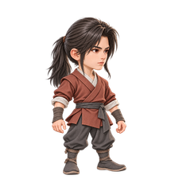
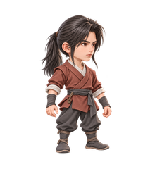
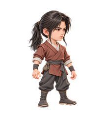

# 凡人主角 · 第二轮定向微调

日期：2026-10-18。状态：**M1、M2、M3 的 v2 待产品审核，方向继续收敛，尚未最终定稿。**

产品称上轮所选方向为“图1”，列出的低马尾、侧分碎发、冷静坚定的眼神、赭红短交领衣，对应本地 [A3-v4.png](../round-01-v1/raw/A3-v4.png)。本轮以此人物方向继续修改，不重新设计 A1/A2/A3，也不把选定修改方向视为最终造型确认。整体仍遵循 A｜国漫仙侠·精致微缩风、高质量 2.5D、约 2.8—3 头身、右向四分之三视角与左上柔光。

## 当前三个同人小变体

下列为 220×240 透明预览，点击可查看 v2 高清原图。请同时查看浅、深底版本，按 100% 像素判断脸部、剪影、衣着和配件的可读性。

| 变体 | 透明预览 | 微调方向与文件 |
| --- | --- | --- |
| **M1 · 素布微调** |  | 素布衣着，无挂饰。 [v2 原图](raw/M1-v2.png) · [透明](previews/M1-220x240.png) · [浅底](previews/M1-220x240-light.png) · [深底](previews/M1-220x240-dark.png) |
| **M2 · 小旧铜佩** |  | 同一人物，仅保留一枚小旧铜佩。 [v2 原图](raw/M2-v2.png) · [透明](previews/M2-220x240.png) · [浅底](previews/M2-220x240-light.png) · [深底](previews/M2-220x240-dark.png) |
| **M3 · 随身布囊** |  | 小布囊、窄护腕及较简素的布靴。 [v2 原图](raw/M3-v2.png) · [透明](previews/M3-220x240.png) · [浅底](previews/M3-220x240-light.png) · [深底](previews/M3-220x240-dark.png) |

三张分别生成并独立保存，没有拼成多人信息图。v2 继续针对密纹和战斗化护腕做简化；成图仍有细纹，不能据此称为完全去纹或已经消除成熟感。衣料朴素程度、年龄感、配件取舍及人物一致性仍以产品审核为准。

## 版本与来源

候选均使用内置 GPT Image/imagegen 生成。本目录保留 [raw/](raw/) 中的 v1、v2 共六张原始 PNG，以及 [prompts/](prompts/) 中对应的六份提示词，不覆盖过程稿。

| 版本 | 迭代内容 | 原图 |
| --- | --- | --- |
| v1 | 沿上轮 A3-v4 人物方向进行首轮定向微调 | [M1](raw/M1-v1.png) · [M2](raw/M2-v1.png) · [M3](raw/M3-v1.png) |
| v2 | 进一步针对密纹、战斗化护腕进行清理，当前待审 | [M1](raw/M1-v2.png) · [M2](raw/M2-v2.png) · [M3](raw/M3-v2.png) |

当前三张 v2 原图均为 **1024×1536、RGBA、真 alpha**，alpha 范围为 **0..254**；零星低 alpha 像素保留。[preview-report.json](preview-report.json) 的 `source_version=v2` 记录原图哈希、透明范围、缩放和定位参数；生成与版本来源见 [generation-record.json](generation-record.json)。[make_previews.py](make_previews.py) 仅按非零 alpha 包围盒等比缩图并合成浅深背景，不重绘或修改源 PNG。这些预览未经过游戏骨骼、缓存或窗口渲染链，不构成运行资产验收。

## 审核边界与后续

当前仅确认继续修改上述人物方向；M1/M2/M3 尚未选定，人物最终造型尚未确认。本轮没有生成炼气或筑基，没有拆分 12 格图集，没有接入 `Assets` 或修改游戏代码。原始 PNG 是光栅图，不能冒充分层 PSD 或制作完成的游戏资产；分件、隐藏连接区、锚点及动画仍待后续单独制作和验证。

产品确认修改版本后，再按既定流程延展同一人的三阶段、制作游戏资产、接入并验收。配套依据见 [第一轮候选与历史记录](../round-01-v1/README.md)、[美术重制第一阶段](../../../设计/美术重制第一阶段/README.md)及[标准修士角色视觉设计方案](../../../设计/美术重制第一阶段/标准修士角色视觉设计方案.md)；原有图集、骨骼与技术候选规范保持不变。

## 后续选择记录：M2 正式基准

2026-10-18，产品正式选择本目录的 [M2-v2](raw/M2-v2.png) 作为凡人期标准主角基准，批准低马尾、侧分碎发、冷静坚定眼神、红褐短交领衣、灰裤布靴及小旧铜佩的核心设计，比例约 2.8—3 头身；不再重新选择人物。产品仅授权最后一张小幅精修，简化密纹并加强朴素感，不加入布囊或额外饰品。当前单张精修 v2 待产品最终确认，仍保留自然细纹；v1 仅作内部过程稿保留，不算新增候选，当前交付为一张精修及一张预览。确认后再直接基于同一人物设计炼气；当前不拆件、不接入游戏，也不宣称图像 QA 或游戏验收通过。

基准与精修状态见 [M2 正式基准](../M2-正式基准/README.md)。上文候选当时的待审状态、M3 布囊方案及历史建议保持原样，不作为本次已选 M2 的最终配置。
