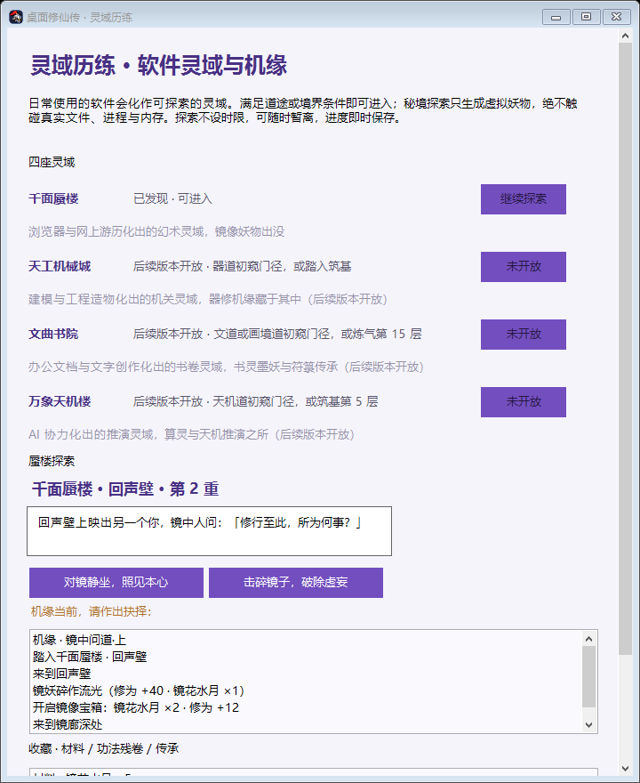

# 《桌面修仙传》V6.0 · 第三阶段：软件灵域与机缘（P3 第一纵切）

分支：`feature/v6-lingyu-realms`（基于第二阶段整改后的 470a7ec，独立 worktree 开发，不影响第一阶段长测与 PR #1 / PR #2）

## 一、本阶段交付的最小闭环

打开修行面板 → 「灵域历练」→ 满足条件进入千面蜃楼 → 节点探索 / 路径选择 / 随机事件 / 机缘抉择 / 虚拟镜妖战斗 → 材料、残卷、传承与修为结算 → 通关主镜获得传承「水月镜符」→ 可暂离、可重访、可再战。

## 二、功能清单

### 1. 四座软件灵域（配置化数据，`LingyuCatalog`）

| 灵域 | 来源道途 | 进入条件（任一） | 本阶段状态 |
|---|---|---|---|
| 千面蜃楼 | 游历道（浏览器） | 游历道 L1，或炼气第 10 层 | **完整可玩** |
| 天工机械城 | 器道（建模/CAD） | 器道 L1，或筑基 | 数据结构与接口预留 |
| 文曲书院 | 文道 + 画境道 | 文/画境道 L1，或炼气第 15 层 | 数据结构与接口预留 |
| 万象天机楼 | 天机道（AI 工具） | 天机道 L1，或筑基第 5 层 | 数据结构与接口预留 |

- 识别规则**直接引用 `BaiyeCatalog` 的道途 id**，不另维护任何进程名映射，两处规则不可能漂移。
- 进入条件双途径：道途等级**或**境界层数。浏览器/建模软件没运行过时，靠修仙境界也能进入，玩法不被软件锁死。
- 扩展接口：新增灵域 = 在 `LingyuCatalog.Realms` 加一条 `LingyuRealmDef`（`Playable=true` + 节点引擎接入点）。

### 2. 千面蜃楼秘境（`MirageEngine`，状态机节点图）

- 节点：镜湖渡口（入口）→ 镜廊深处 / 雾中幽径（随机事件区）→ 回声壁（机缘点）→ 蜃楼中庭（主镜战）。
- 随机事件：镜像宝箱（材料+修为）、镜妖袭击（战斗）、幻术迷雾（传送回渡口+修为）、发现回声壁。
- 战斗：只生成带 `lingyu-` 标记的**虚拟妖物**（蜃楼主战 4 倍耐久）。沿用既有虚拟战斗体系：自动作战会迎击，玩家也可手动点击妖物出击；击败后秘境继续，战败后镜妖遁入镜中（不软锁、不发奖、可再来）。
- 通关：平定镜廊与雾径 → 中庭 → 直面蜃楼主镜 → 通关奖励 + 首次传承「水月镜符」，通关次数落档，可重访再战。
- **中断保存与重访**：每个转移即时存档；战斗挂起状态（含结算语义 `CombatOutcome`）持久化——进程在主镜战中崩溃重启后，重访补发的仍是主镜战，通关奖励不丢失。

### 3. 随机机缘框架（`JiyuanEngine`，数据定义驱动）

每条机缘 = 触发节点 + 前置条件（灵根/境界/百业道途/通关次数/历史选择）+ 随机几率 + 玩家选择 + 不同结果，全部经统一结算接口发放并记录存档。首批 4 条：

- **连续机缘「镜中问道·上/下」**：回声壁自问（静坐得修为 / 碎镜触发战斗），下幕在中庭解锁（需上幕记录 + 炼气 12 层 + 通关 1 次），**结果因上幕选择分叉**（静坐→功法残卷「镜心残卷」；碎镜→碎镜晶 ×2）。
- **灵根共鸣**（ambient 示例）：水灵根在渡口触发。
- **镜面花**（随机示例）：游历道 L1 后各节点 15% 几率。
- `Kind` 与 `FollowUpId` 字段为未来连续机缘、特殊 NPC 与软件秘境事件预留。

机缘为一次性（`JiyuanChoices` 落档后不重触发）；机缘战斗的选择**先落档再开战**，胜利按已选结算，失败按已选落空——台账幂等，不存在重复领取路径。

### 4. 奖励结算与收藏（B4）

- 统一入口 `LingyuSettlement.TryGrant`：材料/残卷/传承立即落灵域存档；**修为进入 `PendingQi`**，由控制器按 A1 同款跨存档协议对账（灵域 `PendingQi` ↔ 修仙 `ExternalGrants`）：修仙侧有标记则销账不重发，无则补发不丢失。
- 收藏体系：基础材料（镜花水月/碎镜晶/镜花）、功法残卷（镜心残卷）、传承（水月镜符），在灵域界面「收藏」栏展示。

### 5. 界面与入口

- 修行面板新增「灵域历练」按钮；灵域窗口展示四座灵域（状态/条件/进入）、蜃楼探索区（节点标题/正文/选择按钮/探索记录）、收藏栏。
- 视觉沿用修行面板国风淡紫体系，结构优先，预留完整美术升级。
- 新增 `--lingyu-preview <png>` 预览导出（合成数据，不读真实存档、不触系统探针）。

## 三、存档

灵域独立第四个存档 `%LOCALAPPDATA%/KnightAssistant/lingyu-v1.txt`（版本号 + 原子写入 + `.bak` 回退），与 adventure-v1 / cultivation-v2 / baiye-v1 互不干扰；旧档升级时无此文件则全新开始，不覆盖任何历史记录。读取侧全部校验：未知版本安全重来，非法 token、未知灵域、越界数值一律拒收。

## 四、红线自查

- 普通权限可运行：灵域全部逻辑无特权调用。✅
- 不读隐私内容：灵域只消费百业道途等级，不新增任何系统探测。✅
- 秘境不触发真实文件删除/进程关闭/内存回收：战斗只走 `IsVirtual` 妖物路径（`SettleVirtual`），冒烟断言虚拟击杀不触碰文件。✅
- 与 CultivationProgress、战斗模块、真实维护模块解耦：控制器集成点为独立方法，维护授权逻辑零改动。✅

## 五、测试

- `LingyuSelfTest`：**64 项**——名册与双途径进入门控、幂等发放与跨存档两窗口对账、存档全字段往返/损坏回退/未知版本/非法行拒收/暂离保留节点、种子随机蜃楼全流程通关（有界驱动）、战斗中重启补发（普通战+主镜战）、战败出口、机缘灵根/道途/随机门控与一次性、连续机缘 A/B 分支、机缘战斗先落档后结算。
- 冒烟追加（82→**93**）：控制器路径的进入门控、完整通关驱动、秘境妖物生成与击杀回调、战败力竭出口、示范运行不写真实灵域档。
- 全量：`--selftest` 绿（含 Lingyu 64），`--adventure-smoke` 绿（93+16+22）。
- 真实 GUI 联动与长测观测：等第一阶段 6–8 小时长测结束后合并验证（本阶段所有测试均在隔离 worktree 的示范/合成环境完成，未触碰长测进程与真实存档）。

## 六、已知问题与后续

1. 一键清场可以立即击败蜃楼主（视为玩家主动选择，奖励照结算）；如需主镜免疫清场，后续加标记位。
2. 机缘待定状态是内存态，重启后在当前节点重新评估（一次性记录防重，已完成的机缘不会重复出现）。
3. 天工机械城/文曲书院/万象天机楼为数据与接口预留，节点引擎待各自纵切。
4. 灵域界面为结构优先的素颜版本，等待统一美术升级。
